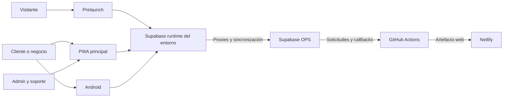

# 01 · Mapa y primer día

ReferidosAPP reúne descubrimiento de promociones, canje por QR, gestión de negocios y atención por tickets. Prelaunch capta interés antes de entrar al producto. La PWA principal es la superficie web funcional y Android tiene su propia implementación para los mismos dominios. El repositorio también reúne un laboratorio web de diseño y herramientas internas para entregar versiones y supervisar la operación.

| Carpeta | Lo que encuentras | Empieza en |
| --- | --- | --- |
| `apps/referidos-app` | PWA en React, Vite y Tailwind para cliente, negocio, soporte y admin. | [Rutas](../apps/referidos-app/src/routes.jsx) y [store](../apps/referidos-app/src/store/appStore.js) |
| `apps/prelaunch` | Lista de espera, ayuda, soporte anónimo y feedback. | [Entrada y rutas](../apps/prelaunch/src/main.jsx) |
| `apps/referidos-android` | React Native, navegación por rol, cámara, ubicación y módulos nativos. | [Entrada JS](../apps/referidos-android/index.js) y [App](../apps/referidos-android/src/app/App.tsx) |
| `apps/referidos-pwa` | Prototipos de auth y pantallas de promoción. | [Rutas](../apps/referidos-pwa/src/routes.jsx) |
| `apps/referidos-app/supabase` | Esquema y Edge Functions para los runtime de dev, staging y prod. | [Configuración](../apps/referidos-app/supabase/config.toml) |
| `apps/referidos-ops/supabase` | Esquema y funciones para releases, despliegues, catálogos y telemetría. | [Configuración OPS](../apps/referidos-ops/supabase/config.toml) |
| `packages` | Lógica común, SDK y adaptadores. | [Paquetes y contratos](06-paquetes-compartidos.md) |
| `.github/workflows`, `tooling`, `versioning`, `scripts` | CI, automatización de releases, builds y entorno local. | [Versionado y despliegue](07-versionado-y-despliegue.md) |
| `docs`, `assets` | Guías existentes y recursos vigentes o históricos. | [Índice original](../docs/README.md) |

## Entornos

| Entorno | Responsabilidad | Cómo lo reconoce el código |
| --- | --- | --- |
| Development | Desarrollo y verificación inicial. | Los scripts `dev:*` arrancan Vite en modo `remote`. La configuración decide a qué Supabase conecta. |
| Staging | Validación de integración y del artefacto antes de promover. | El workflow resuelve su propio sitio Netlify y runtime por producto. |
| Producción | Entorno de lanzamiento. | Runtime y destinos web propios. La entrega se asocia al commit y artefacto de la versión. |
| OPS | Control separado, compartido por los runtime. | Recibe operaciones de los proxies y de CI, y registra entorno y proyecto cuando el dominio lo requiere. |

La web toma configuración de `public/app-config.js` y las variables Vite. Android lee `env.json` y contempla un fallback a variables de entorno. En los clientes se usan claves publicables. Los secretos elevados corresponden a Edge Functions o CI. [Entornos y secretos](../docs/referidos-system/entornos-y-secrets.md) · [Contrato de variables](../versioning/env.contract.json)

## Arranque desde Windows

1. Revisa los workspaces y scripts en el [manifiesto raíz](../package.json). CI usa Node 22 para sus gates de PR. En una instalación limpia, `npm ci` usa el lockfile del repo.
2. Revisa qué Supabase configuraste antes de usar un formulario o crear una cuenta. El modo `remote` describe cómo se sirve Vite, y los valores de configuración determinan el entorno que recibe las solicitudes.
3. Levanta una app con los comandos de abajo y abre la URL que imprima la herramienta. Los scripts web usan `--host`, lo que puede exponer el servidor en la red local.
4. Para Android, identifica primero JDK, SDK, NDK y el dispositivo. Algunos wrappers tienen rutas de la máquina original. [Guía Android](04-android.md) · [Runbook histórico](../docs/android-console-runbook.md)

| Quiero abrir | Comando en la raíz |
| --- | --- |
| PWA funcional | `npm run dev:app` |
| Landing pública | `npm run dev:prelaunch` |
| Laboratorio web | `npm run dev:pwa` |
| Android | `npm run android:metro` y `npm run android:run` en terminales separadas |

## Dónde se decide cada cosa

El router decide qué pantalla se monta. El store conserva el estado. Supabase Auth emite la sesión. El backend determina qué puede leer o cambiar esa sesión. Una Edge Function con clave de servicio necesita su propio control de identidad y rol. Si el cliente llega directamente a una tabla o RPC, el contrato incluye sus grants, RLS y SQL.

Las guías anteriores ayudan a entender la intención del diseño. Para una ruta actual, parte del router. Para ver si una migración está aplicada o un artefacto se publicó, consulta el entorno correspondiente.
