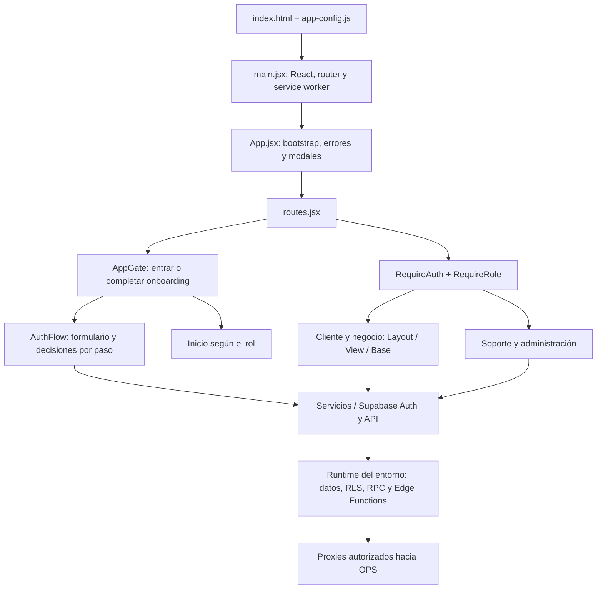

# 02 · La PWA principal

[Volver al índice](README.md)

`apps/referidos-app` es el frontend web funcional de ReferidosAPP. Permite entrar como cliente, negocio, administrador o agente de soporte. Usa React, React Router, Zustand, Vite y un cliente de Supabase en navegador. `apps/referidos-pwa` es otro workspace con maquetas. Para retomar el producto, abre primero [el enrutador de la app principal](../apps/referidos-app/src/routes.jsx).

## Un recorrido que une las piezas

La navegación controla la experiencia del usuario. La autorización real de datos se aplica en Supabase mediante permisos, RLS, RPC y validaciones de las Edge Functions. Cambiar un rol en una ruta o mostrar un botón nuevo modifica la interfaz. Para modificar quién puede ejecutar la operación, encuentra también su contrato en el backend.

## Arranque y configuración

1. [index.html](../apps/referidos-app/index.html) monta el nodo `root`, declara metadatos del sitio y carga `/app-config.js` antes del módulo de la app. Ese orden permite que el proveedor del despliegue coloque URL publicable, canal y metadatos de release para el entorno que corresponda.
2. [runtimeConfig.js](../apps/referidos-app/src/config/runtimeConfig.js) combina `window.__REFERIDOS_RUNTIME_CONFIG__` con variables `VITE_*`. [supabaseClient.js](../apps/referidos-app/src/lib/supabaseClient.js) instancia un cliente único, exige URL y clave publicable e inicia Auth con PKCE. Esas claves están destinadas al cliente. Cualquier variable accesible al frontend se debe tratar como pública.
3. [main.jsx](../apps/referidos-app/src/main.jsx) carga CSS, monta React bajo `BrowserRouter` y registra el service worker de Vite en producción fuera de los hosts locales identificados. El manifiesto del plugin se configura en [vite.config.js](../apps/referidos-app/vite.config.js). También existen archivos públicos históricos de manifiesto y worker. Revisa el HTML, el manifiesto y el registro del worker en el artefacto de la release cuando depures instalación o caché.
4. [App.jsx](../apps/referidos-app/src/App.jsx) monta el límite de errores, la conexión al runtime de errores, el proveedor de modales y las rutas con `Suspense`. Los hooks globales arrancan el bootstrap de autenticación y la captura de eventos.
5. [routes.jsx](../apps/referidos-app/src/routes.jsx) es el índice fiable de rutas. Carga en forma diferida varias páginas, sobre todo administración, auth y legal. Las rutas protegidas combinan `RequireAuth` y `RequireRole`; hay redirecciones de rutas antiguas para conservar enlaces.

### Modos y rutas para retomar

| Entrada | Qué abre | Dónde hacer el primer cambio |
| --- | --- | --- |
| `/`, `/auth`, `/app` | Entrada pública, onboarding y despacho al inicio de rol | [AppGate.jsx](../apps/referidos-app/src/pages/AppGate.jsx), [AuthFlow.jsx](../apps/referidos-app/src/auth/AuthFlow.jsx) |
| `/inicio` | Landing incluida en la propia PWA | [LandingPage.jsx](../apps/referidos-app/src/landing/LandingPage.jsx) |
| `/cliente/{inicio,escanear,historial,perfil}` | Navegación autenticada de cliente | [Layout](../apps/referidos-app/src/cliente/layout/ClienteLayout.jsx), [vistas](../apps/referidos-app/src/cliente/views/) |
| `/detalle/:id` | Detalle de promoción y QR para cliente | [PromoDetalle.jsx](../apps/referidos-app/src/pages/PromoDetalle.jsx) |
| `/negocio/{inicio,escanear,gestionar,perfil}` | Navegación autenticada de negocio | [Layout](../apps/referidos-app/src/negocio/layout/NegocioLayout.jsx), [vistas](../apps/referidos-app/src/negocio/views/) |
| `/soporte/*` | Bandeja, jornadas, incidencias, tickets y catálogo de errores | [Rutas](../apps/referidos-app/src/routes.jsx), [agente del SDK](../packages/support-sdk/src/agent/) |
| `/admin/*` | Operación de producto, observabilidad, releases, soporte y datos | [Páginas](../apps/referidos-app/src/pages/admin/), [módulos de admin](../apps/referidos-app/src/admin/) |
| `/legal/:locale/:document` | Documentos públicos, incluidos privacidad, términos y eliminación de datos | [LegalRouter.jsx](../apps/referidos-app/src/legal/LegalRouter.jsx), [legal-content](../packages/legal-content/) |

## Auth y onboarding

El estado inicial vive en [appStore.js](../apps/referidos-app/src/store/appStore.js). `bootstrap` indica que el store está resolviendo la sesión. `usuario === undefined` identifica el arranque pendiente y `usuario === null` identifica la ausencia de un perfil utilizable para la ruta. `bootstrapAuth` coordina comprobación de sesión, asociación del dispositivo y llamada a `onboarding`. Mantiene una promesa en curso para evitar duplicar el bootstrap. La opción `force` permite repetir la evaluación después de una escritura de perfil. El store Zustand preserva el nombre histórico de persistencia, pero su `partialize` devuelve un objeto vacío. La persistencia de sesión de Auth pertenece al cliente Supabase.

[AppGate.jsx](../apps/referidos-app/src/pages/AppGate.jsx) lee la sesión, `onboarding.allowAccess`, las razones de rechazo, los indicadores de pasos de cliente y el estado de verificación. El gate puede intentar `validate-registration` cuando ve el estado de cuenta pendiente en condiciones concretas, y luego recalcula el bootstrap. También abre el flujo de cambio de contraseña cuando un usuario interno lo requiere. Al aprobar el acceso envía a admin a `/admin/inicio`, soporte a `/soporte/inbox`, negocio a `/negocio/inicio` y el resto al inicio de cliente. Las rutas directas vuelven a revisar sesión, MFA y rol.

[AuthFlow.jsx](../apps/referidos-app/src/auth/AuthFlow.jsx) decide qué paso renderizar y conecta los formularios con estado y acciones. [useAuthFlow.js](../apps/referidos-app/src/auth/hooks/useAuthFlow.js) controla valores de formulario, navegación y medición de alturas. [useAuthActions.js](../apps/referidos-app/src/auth/hooks/useAuthActions.js) maneja los efectos externos. Separa cuenta de Supabase Auth de perfil de negocio o cliente en `usuarios`. El registro con negocio añade validación de código invitación y datos de negocio, categoría, ubicación y verificación. Los hooks de email, ubicación y contraseña aíslan formularios que tienen su propio ciclo de vida.

Para cambiar un paso, sigue **constante en `auth/constants/authSteps.js` → presentación en `auth/steps` → orquestación en `AuthFlow.jsx` → mutación en `useAuthActions.js` o servicio → respuesta de `onboarding`**. Esto evita arreglar una pantalla mientras se pierde la capacidad de reanudar el flujo tras recargar.

El PIN y la biometría locales están separados del segundo factor de Supabase. [secureStorageService.js](../apps/referidos-app/src/services/secureStorageService.js) usa IndexedDB y Web Crypto para material de dispositivo, con PBKDF2 para el PIN. La clave de envoltura y el material cifrado están en el mismo almacenamiento del origen, así que este flujo sirve como bloqueo de interfaz y protección local limitada. [mfaService.js](../apps/referidos-app/src/services/mfaService.js) maneja factores TOTP y nivel de garantía de Supabase. [useMfaGate.js](../apps/referidos-app/src/hooks/useMfaGate.js) coordina el desafío y bloqueo en el frontend. La sensibilidad de una operación debe comprobarse en el servidor que la ejecuta.

## Cliente, negocio y QR

Los dos roles principales tienen `layout/`, `views/`, `base/` y módulos por pantalla. Sigue la ruta antes de elegir entre nombres duplicados. `views/` conecta la ruta con el caché y los contextos del rol. `base/` tiene elementos renderizados desde el caché o usados al componer páginas. `inicio/`, `historial/` y `gestionar/` contienen las secciones que muestran los datos. En paralelo, `src/pages/cliente` y `src/pages/negocio` conservan wrappers separados. Busca referencias en `routes.jsx` y en el layout para distinguir qué código participa en el flujo que estás tocando.

[cacheStore.js](../apps/referidos-app/src/cache/cacheStore.js) guarda vistas por rol y posiciones de scroll. Los layouts precargan las pestañas. [CacheOutlet.jsx](../apps/referidos-app/src/cache/CacheOutlet.jsx) conserva las vistas inactivas y oculta sus nodos con CSS. Al navegar, un efecto de cámara, geolocalización, temporizador o suscripción puede seguir vivo si el componente oculto no escucha su estado activo. Las bases del escáner y gestión usan información del layout para coordinar la barra superior y su activación.

| Flujo | Desde la pantalla hasta los datos | Qué debes preservar al cambiarlo |
| --- | --- | --- |
| Inicio y exploración | `cliente/inicio` → `appStore.loadPromos` → `promoService.getActivePromos` → tabla `promos` | Filtros de estado, fechas, relación con negocio y sucursales, carga y caché de la sesión. `usePromoSearch` sirve para búsqueda en UI. |
| Detalle y generación | `PromoDetalle.jsx` → `promoService.getPromoById` / `qrService` → `generate_promo_qr`, `get_active_valid_qr`, `generate_valid_qr` | La promoción identificada por la URL y el QR válido tienen ciclos distintos. La fecha de expiración y el resultado vienen del backend. |
| Cámara y canje | Layout del rol → `ScannerView` → `useScannerState`. Cliente muestra el tipo de código reconocido. Negocio llama a `redeemValidQr` → RPC `redeem_valid_qr` para códigos válidos. | Entrada manual, permisos del navegador, bloqueo durante procesamiento e interpretación del resultado del servidor. |
| Historial de cliente | `HistorialView.jsx` → `qrService.getQrHistory` → RPC `get_qr_history` | El reloj de render afecta expiraciones visibles. Los estados históricos deben seguir el contrato devuelto por la RPC. |
| Gestión y perfil | `negocio/gestionar` y `profile` → secciones, hooks y servicios | Identifica qué panel usa datos reales y cuál muestra una vista preliminar. Los cambios de sesión, MFA, soporte o cuenta tienen rutas de datos diferentes. |

La búsqueda visual también tiene copias o variantes en `src/search`, `components/search` y los paneles de cabecera. Antes de consolidarlas, sigue las importaciones desde la pantalla que ves. La variante de dirección, la de promos y la de perfil buscan contenidos diferentes y no comparten todas las reglas.

## Soporte, admin y OPS

El **usuario** abre ayuda y tickets desde el perfil mediante piezas de [profile/shared](../apps/referidos-app/src/profile/shared/) y [supportChatClient.js](../apps/referidos-app/src/profile/shared/services/supportChatClient.js). El **agente** entra por `/soporte/*`, cuyas pantallas se importan desde `packages/support-sdk`. El **administrador** gestiona agentes, tickets y catálogo desde `admin/support`. Esa distribución mantiene la experiencia de usuario dentro de su perfil y permite reutilizar la lógica de operación del agente.

El panel de **administración** alterna consultas al runtime del producto y llamadas Edge para mutaciones o recursos de OPS. [AdminLayout.jsx](../apps/referidos-app/src/admin/layout/AdminLayout.jsx), `AdminTopbar` y `AdminSidebar` dan estructura a las páginas. Las tablas de usuarios, negocios, promos, QR, reportes y logs son independientes. Para cambios de estado, localiza primero la llamada de la pantalla y confirma si usa una Edge Function o acceso bajo RLS.

Para versionado, `/admin/versionado/global` y `/admin/versionado/detalle` llegan a [versioningService.js](../apps/referidos-app/src/admin/versioning/services/versioningService.js), que invoca `versioning-ops-proxy`. Para las apps y macros de soporte, los servicios frontend invocan `support-ops-proxy` y despachadores de sincronización. Para la DLQ, [opsTelemetryDlqService.js](../apps/referidos-app/src/admin/dashboard/services/opsTelemetryDlqService.js) usa `ops-telemetry-admin-proxy`. El contrato de panel y proxy debe evolucionar junto con la RPC de OPS. La vista de detalle de DLQ tiene cambios locales hacia metadatos y existe una migración OPS local asociada.

La observabilidad parte de [loggingClient.js](../apps/referidos-app/src/services/loggingClient.js) y del paquete compartido. El cliente agrega contexto y breadcrumbs, registra la release mediante una función Edge y envía eventos a ingestión. Los paneles de incidencias y catálogo de errores permiten inspeccionar lo que llegó. Si el fallo es visible en la interfaz, sigue `ErrorRuntimeBridge` y `errorPolicyService` para entender si corresponde modal, reintento, bloqueo o salida de sesión.

## Dónde empezar según el cambio

| Cambio | Primer punto de lectura | Segundo punto de lectura |
| --- | --- | --- |
| Inicio de sesión atrapado o onboarding que vuelve a empezar | `AppGate.jsx`, `auth/AuthFlow.jsx` | `store/appStore.js`, `onboardingClient.js`, contrato de la función Edge |
| Promoción ausente o caducada | `cliente/inicio/InicioPromos.jsx`, `pages/PromoDetalle.jsx` | `promoService.js`, reglas y datos de `promos` |
| Cámara o canje QR | `scanner/hooks/useScannerState.ts` | `qrService.js`, RPC de QR y permisos de cámara |
| Menú inferior, encabezado o scroll | Layout del rol y `cache/` | Contexto de encabezado y `layouts/footer` |
| Datos de perfil o verificación | `profile/shared/sections`, `auth/steps` | Mutación concreta del servicio y permisos del servidor |
| Ticket, disponibilidad de agente o macro | `profile/shared/services/supportChatClient.js` o `packages/support-sdk` | `admin/support`, Edge Functions de soporte o sincronización con OPS |
| Release, despliegue o cola de errores | `admin/versioning`, `admin/dashboard` | Proxies runtime, RPC de OPS y workflows |

## Observaciones al retomar

- **Firma de `pwaGuard`.** [App.jsx](../apps/referidos-app/src/App.jsx) invoca el guard con un objeto. [pwaGuard.js](../apps/referidos-app/src/router/guards/pwaGuard.js) declara argumentos posicionales y usa `pathname.startsWith`. En modo standalone, eso puede lanzar una excepción atrapada por el wrapper y omitir la redirección. Alinea firma y llamada, y revisa la intención del guard para rutas legales, soporte y detalle de promo antes de activarlo.
- **Autorización de perfil.** El alta y algunos cambios usan la tabla `usuarios` directamente. Antes de confiar en el rol leído por el frontend o por un proxy, comprueba los privilegios de escritura sobre los campos de rol y estado en la base del entorno. Corrige las reglas en el backend y conserva las escrituras de perfil legítimas.
- **Caché de pantallas.** El caché de vistas mejora el regreso a una pestaña pero puede aumentar el trabajo de arranque. Mide tiempos y suscripciones antes de pasar más pantallas a precarga. Los módulos de soporte y algunos paneles se importan de forma estática desde `routes.jsx`.
- **Manifiestos y mapas de origen.** Hay un manifiesto configurado en Vite y manifiestos estáticos. Comprueba cuál sirve el build que se publica. Vite también genera mapas de origen ocultos. Revisa que el artefacto público separe esos archivos de los mapas destinados a observabilidad.
- **Vistas de muestra.** Hay componentes `Preview`, métricas mock y componentes con nombres repetidos. Confirma la ruta, sus importaciones y la llamada de datos antes de asumir que lo visible es una consulta real.

## Referencia archivo por archivo

- [Arranque, estado, seguridad, auth y servicios](referencia/02-pwa-nucleo.md)
- [Cliente, negocio, perfil, búsqueda y escáner](referencia/02-pwa-producto.md)
- [Administración y soporte](referencia/02-pwa-administracion.md)
- [Componentes compartidos, layouts y modales](referencia/02-pwa-interfaz.md)
- [Configuración, activos, manifiestos y documentación existente](referencia/02-pwa-publico.md)

La referencia distingue ruta fuente, símbolos, dependencias y consumidores visibles por importación. Un archivo sin consumidor localizado puede ser una ruta HTML, un activo público, una referencia dinámica o una pieza histórica. Para comprobar un posible retiro, revisa también atajos, importaciones indirectas, referencias CSS y los artefactos de cada entorno.
