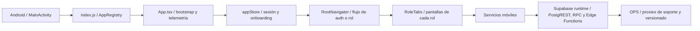

# Android de ReferidosAPP

Android es una aplicación nativa en React Native y TypeScript dentro de `apps/referidos-android`. Reutiliza parte de los contratos de la PWA y se conecta al mismo Supabase del producto para el entorno configurado. Tiene cuatro experiencias por rol: cliente, negocio, soporte y administración. La interfaz móvil, sus permisos, la navegación, el almacenamiento del dispositivo y la compilación son propios. [Manifiesto del workspace](../apps/referidos-android/package.json) · [Guía de Android](../apps/referidos-android/README.md)

## El recorrido completo



1. `MainActivity` solicita el componente `ReferidosAndroid`. `index.js` registra ese nombre desde `app.json`, carga el ajuste de URL para Hermes e importa el árbol React. `MainApplication` inicializa el host, SoLoader y los módulos vinculados por React Native. [Entrada JS](../apps/referidos-android/index.js) · [Actividad Android](../apps/referidos-android/android/app/src/main/java/com/referidosandroid/MainActivity.kt)
2. `App.tsx` consulta el estado de arranque de Zustand, instala la captura de errores globales, mide el tiempo hasta el arranque y la primera ruta, actualiza contexto de dispositivo y manda eventos al SDK. Cuando el arranque está listo, monta `NavigationContainer`, `RootNavigator` y el host común de modales. [App.tsx](../apps/referidos-android/src/app/App.tsx)
3. `appStore.bootstrapAuth` toma la sesión actual de Supabase y, con una sesión activa, invoca `onboarding`. Conserva el perfil, el rol, si se permite acceso y los motivos del resultado. Cliente y negocio con verificación `unverified` o `in_progress` regresan al flujo de autenticación para completar pasos. Al cambiar de rol limpia la memoria de navegación y al salir resetea también seguridad y modales. [appStore.ts](../apps/referidos-android/src/shared/store/appStore.ts)
4. `RootNavigator` elige el árbol y fija su clave según el punto de entrada. `RoleTabs` recuerda la última pestaña por rol mientras vive ese estado y conserva montadas las pestañas inactivas. Soporte y administración añaden pilas de detalle. [RootNavigator.tsx](../apps/referidos-android/src/navigation/RootNavigator.tsx) · [RoleTabs.tsx](../apps/referidos-android/src/navigation/RoleTabs.tsx)
5. Las pantallas llaman `mobileApi`, los servicios de `src/shared/services` o consultas sobre `supabase`. Los permisos efectivos corresponden al backend: RLS para tablas, comprobaciones dentro de las funciones y controles de los proxies para operaciones de OPS. Los menús y validaciones locales ayudan al recorrido de la persona. [mobileApi.ts](../apps/referidos-android/src/shared/services/mobileApi.ts) · [Guía de Supabase](05-supabase-runtime-y-ops.md)

## Qué hace cada rol

| Rol | Pestañas | Flujo a seguir en código |
|---|---|---|
| Cliente | Inicio, Escáner, Historial y Perfil | Inicio muestra cuenta y promociones. Escáner clasifica la entrada y ofrece previsualización. Historial lee los QR del cliente. Perfil incluye acceso, sesiones y tickets. |
| Negocio | Inicio, Escáner, Gestionar y Perfil | Inicio carga negocio, sucursales y promociones. El escáner de negocio canjea QR válidos mediante RPC. Gestionar crea promociones, cambia su estado y mantiene sus vínculos con sucursales. |
| Soporte | Inicio, Inbox, Irregular y Perfil | Inbox permite operar la jornada y abrir tickets. El detalle gestiona apertura, notas, plantillas y cierre. Jornadas, issues y catálogo de errores son rutas de su pila. |
| Administración | Inicio, Usuarios, Soporte, Observabilidad y Perfil | Inicio enlaza métricas, entidades, control de soporte, configuración, documentación y versionado. El stack recorre listas y detalles de esas áreas. |

Las claves de navegación son cadenas internas que la telemetría usa como contexto. Si renombras una ruta, revisa sus usos en `routeKeys.ts`, el stack, los enlaces de las pantallas y los eventos. [routeKeys.ts](../apps/referidos-android/src/navigation/routeKeys.ts)

## Cinco recorridos para volver al código

### 1. Registro, login y OAuth

`AuthFlowScreen.tsx` selecciona un bloque visual según el paso devuelto por `useAuthEngine.ts`. El hook usa reglas de `packages/domain` para resolver el paso siguiente y llama a Supabase Auth por email o proveedor. En OAuth abre el navegador y recibe el callback con `Linking`, tanto al arrancar de cero como con la aplicación abierta. El manifest declara el esquema `referidosandroid://auth/callback` y el cliente móvil usa PKCE. El registro guarda datos del usuario, del negocio y de dirección en etapas, luego solicita validación y vuelve a consultar onboarding. Cambios de contrato en permisos o columnas de `usuarios`, `negocios`, `direcciones` y `sucursales` afectan esas escrituras en cadena. [Pantalla de auth](../apps/referidos-android/src/features/auth/AuthFlowScreen.tsx) · [Motor de flujos](../apps/referidos-android/src/features/auth/hooks/useAuthEngine.ts) · [Dominio de autenticación](../packages/domain/src/auth/flowRules.js)

### 2. Dirección, territorio y GPS

`AddressStepBlock.tsx` tiene buscador, selectores territoriales, mapa y entrada manual. Pide permiso de localización para ubicar el mapa, recibe la posición con la biblioteca nativa y admite coordenadas de respaldo. Usa los métodos de dirección de `mobileApi` para buscar, hacer geocodificación inversa y cargar provincias, cantones y parroquias. `useAuthEngine` se ocupa de persistir la dirección y vincularla al usuario o a la sucursal, según el flujo. El bloque es el primer lugar para mirar si falla la selección. El hook es el primer lugar para mirar si la selección funciona y no se guarda. [Bloque de dirección](../apps/referidos-android/src/features/auth/blocks/AddressStepBlock.tsx) · [Cliente API móvil](../packages/api-client/src/createMobileApi.js)

### 3. Escaneo y canje

`NativeQrScannerBlock.tsx` abre la cámara tras comprobar permisos y entrega el código a su pantalla padre. Cliente y negocio también aceptan un código escrito. Cliente distingue los prefijos de códigos estáticos y de canje y refresca onboarding para la previsualización. El escáner de negocio llama a `redeem_valid_qr` mediante `entityQueries.ts`. La función del backend decide el canje y, cuando se confirma, la pantalla recarga el historial. `ScannerGateway.tsx` conserva un placeholder de la migración y queda fuera de las rutas activas. [Cámara](../apps/referidos-android/src/features/scanner/NativeQrScannerBlock.tsx) · [Escáner cliente](../apps/referidos-android/src/features/cliente/ClienteEscanerScreen.tsx) · [Escáner negocio](../apps/referidos-android/src/features/negocio/NegocioEscanerScreen.tsx)

### 4. Soporte y administración de soporte

El perfil de cliente o negocio crea o retoma un hilo mediante `mobileApi.support`. Soporte lee inbox, ficha, notas y eventos del runtime con `supportDeskQueries`. En el detalle, `SoporteTicketScreen` aplica el flujo de atención y adapta las macros según estado, app, entorno y categoría. `supportCatalog.ts` consulta la caché de macros y categorías del runtime. Administración lee o edita el catálogo central por `support-ops-proxy` y puede pedir sincronización. Los perfiles de cliente y negocio todavía importan `supportCategories.ts`; la limpieza histórica de plantillas del agente no elimina esa lista para el formulario del solicitante. [Ticket móvil](../apps/referidos-android/src/features/support/SoporteTicketScreen.tsx) · [Catálogo de soporte](../apps/referidos-android/src/shared/services/supportCatalog.ts) · [Operaciones de soporte](../apps/referidos-android/src/shared/services/supportOps.ts)

### 5. Observabilidad y operación

`App.tsx` adjunta contexto de app, usuario, ruta, red y dispositivo. `@referidos/observability-sdk` controla cola, filtrado y envío mediante `mobileApi`. Administración consulta eventos, issues y catálogo desde sus pantallas, y soporte obtiene su vista de eventos a través de las consultas del escritorio. Para versiones, `AdminVersioningScreen` usa `versioningService.ts`, que llama al runtime por `versioning-ops-proxy`. El proyecto seleccionado por Android se define en su configuración local. El campo `env` de telemetría en Android se deriva de `__DEV__`, que distingue el modo de compilación y puede diferir del entorno Supabase elegido. [SDK de observabilidad móvil](../packages/observability-sdk/src/createMobileObservabilityClient.js) · [Servicio de versionado Android](../apps/referidos-android/src/shared/services/versioningService.ts)

## Cómo retomarlo en Windows

Los ejemplos dev, staging y producción viven en la raíz de `apps/referidos-android`. Copia el ejemplo del entorno que quieras usar a `env.json` y completa la URL, la clave publicable, la versión y la URL de retorno. `env.ts` prioriza ese archivo, valida los campos necesarios y usa el esquema de Android como callback por defecto. El runbook recoge el JDK, SDK, NDK y variables que espera este checkout. Los scripts Windows tienen algunas rutas específicas de la máquina. [Configuración de entorno](../apps/referidos-android/src/shared/constants/env.ts) · [Runbook Android](../docs/android-console-runbook.md)

Desde la raíz, levanta Metro en una terminal y la aplicación en otra:

```powershell
npm run android:metro
npm run android:run
```

El lanzador usa el puerto 8081 por defecto. Si fijas `RN_METRO_PORT`, ajusta también el comando de ejecución para usar el mismo puerto. Con un dispositivo o emulador y las herramientas instaladas, `npm run android:assemble:debug` genera el APK debug, y el workspace ofrece `npm run typecheck -w @apps/referidos-android` y `npm run lint -w @apps/referidos-android`. La referencia de compilación explica qué comprueba cada script por fase. [Scripts declarados](../package.json) · [Configuración del workspace Android](../apps/referidos-android/package.json)

## Qué conviene comprobar al reanudar

- **Permisos de perfiles.** Las pantallas de alta y verificación escriben en tablas del runtime. Coordina los cambios de RLS o de columnas con el flujo móvil y la PWA, especialmente antes de limitar la edición de `usuarios`. [Motor de alta y verificación](../apps/referidos-android/src/features/auth/hooks/useAuthEngine.ts)
- **Seguridad del perfil.** La reautenticación sensible termina hoy en estado local. El PIN usa almacenamiento local y el proveedor biométrico actual de `platform-rn` responde `not_configured`. La interfaz está preparada, pero el código disponible no confirma un backend de biometría funcional. [Seguridad local](../apps/referidos-android/src/shared/security/localAccessSecurity.ts) · [Adaptador de biometría](../packages/platform-rn/src/biometrics/biometricService.js)
- **Separación de flags.** Los flags de soporte se leen de `support_runtime_flags`. Las preferencias de flags de sistema guardadas por `systemFeatureFlags.ts` viven en el dispositivo. Verifica el punto de consumo de cada flag antes de tratarlo como control global. [Flags del sistema](../apps/referidos-android/src/shared/services/systemFeatureFlags.ts) · [Flags de soporte](../apps/referidos-android/src/shared/services/supportRuntimeFlags.ts)
- **Distribución.** El script de release del checkout compila un APK de prueba y puede crear un keystore local. Gradle permite recurrir al certificado debug. Antes de distribuir, prepara un circuito de publicación con firma y versión controladas. La matriz histórica de paridad documenta el alcance certificado en su fecha y sirve de guía de recorrido. [Gradle de la app](../apps/referidos-android/android/app/build.gradle) · [Matriz histórica](../docs/android-parity-certification-matrix.md)

## Referencia técnica por archivo

- [Código de Android, arranque y pantallas](referencia/04-android-pantallas.md)
- [Servicios, estado, seguridad y componentes compartidos](referencia/04-android-servicios.md)
- [Configuración, código Android nativo, recursos y scripts](referencia/04-android-build.md)
