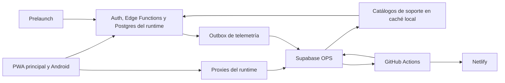

# Supabase, del runtime al control operativo

## Qué sistema estás mirando

ReferidosAPP usa tres proyectos de Supabase con el mismo código de runtime y datos separados. La aplicación web principal y Android usan ese runtime para cuentas y negocio. Prelaunch usa parte de sus endpoints públicos, principalmente captación, soporte anónimo, feedback y telemetría. Un cuarto proyecto, `referidos-ops`, mantiene el trabajo transversal de releases, despliegues, telemetría central y catálogos de soporte. El proxy runtime es la frontera entre el panel web y OPS.

| Entorno o plano | Referencia documentada | Papel |
| --- | --- | --- |
| Development | `btvrtxdizqsqrzdsgvsj` | Runtime para integración y desarrollo compartido. |
| Staging | `iegjfeaadayfvqockwov` | Runtime para revisar la release candidata y su configuración. |
| Producción | `ztcsrfwvjgqnmhnlpeye` | Runtime de la versión de lanzamiento. |
| OPS | `ymhaveuksdzlfuecvkmx` | Control central de versionado, artefactos, historial operativo y catálogos. |

Estas referencias vienen de la documentación versionada. Los proyectos remotos tienen sus propias migraciones aplicadas, variables, configuraciones de Auth y versiones de funciones. El checkout permite describir la intención y el contrato del código, y cada entorno requiere comprobación independiente. [Entornos y secretos](../docs/referidos-system/entornos-y-secrets.md) · [Proyecto OPS](../apps/referidos-ops/README.md)

## Cómo seguir una petición

### Sesión, identidad y onboarding

1. El cliente inicia sesión en Supabase Auth. Auth identifica a la persona mediante un UUID. Las tablas de negocio enlazan ese UUID en `public.usuarios.id_auth` y usan su propio ID de perfil para relaciones. Cuando agregues una consulta, comprueba cuál de los dos identificadores espera.
2. La función `onboarding` valida la sesión y reúne perfil, negocio, direcciones y sucursales. Evalúa la completitud y el estado de cuenta y puede sincronizar datos de identidad. Su respuesta `allowAccess` y sus razones informan a la interfaz en qué paso debe quedar.
3. `validate-registration` comprueba si el alta reúne las condiciones para activar el perfil y, para negocio, sus datos relacionados. Los códigos de acceso tienen endpoints separados de generación, consulta, revocación y validación. Así el mecanismo de acceso puede evolucionar sin embutirlo en los formularios.
4. `session-register`, `session-list`, `session-revoke` y `session-revoke-all` administran `user_session_devices`. El backend separa el identificador del dispositivo del identificador de sesión del JWT. La lógica compartida autentica al usuario antes de confiar en los datos extraídos del token. Las migraciones también agregan un hook de Auth y políticas restrictivas para las tablas que incorporan el guard de sesión.
5. Las reglas de navegación por rol viven en los clientes. La autorización de datos se aplica mediante políticas RLS, privilegios y comprobaciones Edge. Dentro de una Edge Function, si el código opera con privilegios de servidor, debe recuperar el perfil confiable y comprobar rol, tenant, titularidad y estado que corresponda a ese recurso.

[Onboarding](../apps/referidos-app/supabase/functions/onboarding/index.ts) · [Validación de registro](../apps/referidos-app/supabase/functions/validate-registration/index.ts) · [Sesiones por dispositivo](../apps/referidos-app/supabase/migrations/20260206_000001_user_session_devices.sql)

### Promoción, QR, consumo y puntos

Las tablas `negocios`, `sucursales`, `promos` y `promos_sucursales` separan la entidad comercial, sus locales, la oferta y dónde aplica. El sistema implica operaciones que pueden competir, como dos intentos de canje. Por eso la generación y el canje de QR viven en funciones SQL junto a los datos y las restricciones, con firma HMAC y registro en `qr_validos` y `escaneos`. La clave de firma se administra en un esquema privado.

Los cambios de grupos y niveles agregan `grupos`, `miembros`, `grupo_canjeos`, `referrals` y un libro de movimientos de puntos (`points_ledger`). `points_rules` contiene reglas por evento y `user_rank_state` materializa el nivel. Si tocas el canje, revisa las últimas redefiniciones de `generate_valid_qr` y `redeem_valid_qr`, pues ahí se juntan las reglas de promoción, grupo, escaneo y recompensa.

[QR y RPC iniciales](../apps/referidos-app/supabase/migrations/20250209_000001_qr_hmac.sql) · [Clave privada](../apps/referidos-app/supabase/migrations/20250210_000001_qr_secret_table.sql) · [Grupos y puntos](../apps/referidos-app/supabase/migrations/20250303_000001_groups_points_tiers.sql)

### Direcciones y verificación de negocio

Los clientes pueden buscar texto o resolver coordenadas mediante `address-search` y `address-reverse`. Los resultados pasan por una normalización común contra catálogos territoriales. `address_search_cache` conserva resultados procesados y, cuando existen, resultados originales para volver a normalizar sin otra consulta al proveedor. El perfil y las sucursales guardan una referencia de dirección. El modelo pasó de columnas planas y una tabla de flags a campos de estado y visibilidad en `negocios`, con una vista pública que concentra lo que se enseña del comercio.

[Normalización](../apps/referidos-app/supabase/functions/_shared/addressNormalize.ts) · [Cambios a visibilidad](../apps/referidos-app/supabase/migrations/20250228_000001_flags_to_negocios_verificacion_update.sql)

### Prelaunch, waitlist y referidos

`prelaunch-ingest` registra eventos y visitantes para el panel de métricas y aplica filtros de entrada. `waitlist-signup` normaliza correo e intención de rol, deduplica y devuelve información de referido. La última migración de waitlist incluye códigos y relaciones propios de esta fase. Vincula la captación con el perfil cuando se cumplen las condiciones de coincidencia y elegibilidad. Un referido pasa por atribución, calificación y recompensa. La contabilización usa una clave de idempotencia en el libro de puntos. Los códigos de referido de waitlist y los códigos de registro pertenecen a flujos distintos. El endpoint de feedback guarda sus propias entradas y eventos.

[Waitlist](../apps/referidos-app/supabase/functions/waitlist-signup/index.ts) · [Reglas de referido](../apps/referidos-app/supabase/migrations/20260332_000049_waitlist_referrals.sql) · [Feedback](../apps/referidos-app/supabase/functions/feedback-submit/index.ts)

### Atención, cola y notificaciones

Los tickets viven en `support_threads`. `support_thread_events` conserva su historial y `support_thread_notes` las notas que los agentes registran. Un ticket autenticado enlaza al perfil de usuario. Un ticket público usa `anon_support_profiles` y un token de seguimiento cuyo hash se guarda en el servidor. La lectura de su estado filtra los campos devueltos. Usuarios, agentes y administración ven filas distintas según las políticas y vistas del runtime.

La asignación manual y automática comparte motor. La elegibilidad depende del perfil operativo y jornada del agente, su modo, capacidad, flags y estado del ticket. Transiciones como `starting`, `in_progress`, `waiting_user`, `queued` y `closing` reflejan el flujo de trabajo. Los agentes registran heartbeats y cierre de jornada. Si queda trabajo pendiente se distinguen los casos que necesitan traspaso. Un trigger puede convertir ciertos eventos de tickets en entradas de `app_notifications`.

Los catálogos de aplicaciones y macros pertenecen a OPS. El panel admin escribe por `support-ops-proxy`. Los dispatchers mantienen una copia local para resolver el origen del ticket y elegir macros sin añadir un viaje a OPS por consulta. Las macros cambian mediante un log de deltas por secuencia. La copia se actualiza de forma oportunista y programada según la configuración del entorno.

[Motor de asignación](../apps/referidos-app/supabase/functions/_shared/supportAutoAssign.ts) · [Migración de notificaciones](../apps/referidos-app/supabase/migrations/20260323_000042_notifications_center.sql) · [Macros y caché](../docs/referidos-system/support-macros-ops-cache.md)

### Observabilidad y sincronización a OPS

El runtime recibe eventos con `obs-ingest`, resuelve tenant y actor cuando puede, sanea el contexto, deduplica a nivel de incidencia y almacena eventos e incidencias por separado. `obs-policy` produce reglas para el cliente. `obs-release` registra identidad de build y `obs-release-sync` trae el snapshot de una release de OPS. La symbolication usa ese contexto para resolver las pilas minificadas.

El envío central es asíncrono. Cambios de observabilidad, soporte y Prelaunch encolan mensajes en `ops_sync_outbox`. `ops-telemetry-sync-dispatch` reclama lotes, los envía, deja estado y calcula cuándo reintentar fallos. OPS valida el origen y deduplica por clave de origen. Mantiene una capa reciente, otra de retención y una DLQ para fallos de ingestión. El panel consulta la próxima purga a través del proxy admin y de RPCs del proyecto OPS.

[Ingesta runtime](../apps/referidos-app/supabase/functions/obs-ingest/index.ts) · [Configuración del envío programado](../docs/referidos-system/ops-telemetry-cold-dispatch.md) · [Ingesta OPS](../apps/referidos-ops/supabase/functions/ops-telemetry-ingest/index.ts)

### Releases, promoción y despliegue

1. El panel web invoca `versioning-ops-proxy` en su runtime. La función resuelve el perfil del administrador y usa la configuración de OPS para consultar o pedir operaciones.
2. Las tablas `version_products`, `version_environments`, `version_components`, `version_changesets` y `version_releases` registran qué se construye, a qué versión pertenece y con qué componentes. Una promoción registra el cambio de entorno. Una solicitud de deploy, su aprobación, su ejecución y el registro del resultado son objetos separados.
3. El release gate comprueba el destino y las migraciones requeridas mediante el inventario del runtime elegido. La sincronización de ramas coordina GitHub, estado de los checks y el commit. La ejecución dispara el workflow previsto para el artefacto aprobado.
4. El workflow y su callback informan el resultado, actualizan el registro y la cabecera de artefacto del entorno, y pueden sincronizar un snapshot de release con observabilidad runtime. El registro de nodos y solicitudes de sincronización local permite reutilizar los artefactos de builds fuera del runner.

El repositorio conserva funciones homónimas de versionado dentro del runtime. Para cambiar el camino actual del panel, sigue la llamada por el proxy hacia OPS. Si encuentras un consumidor antiguo, comprueba su destino antes de quitar una función de compatibilidad.

[Proxy de versionado](../apps/referidos-app/supabase/functions/versioning-ops-proxy/index.ts) · [Release gate OPS](../apps/referidos-ops/supabase/functions/versioning-release-gate/index.ts) · [Sistema de versionado](../docs/versioning-system.md)

## Dónde empezar al retomar el backend

| Trabajo | Primer recorrido |
| --- | --- |
| Ajustar registro o acceso | Cliente y bootstrap, después `onboarding`, `validate-registration` y los permisos de `usuarios`. |
| Promoción, QR o recompensa | Servicio de QR del cliente, RPC SQL vigente, tablas de escaneos y movimientos de puntos. |
| Ajustar tickets o bandeja | Handler correspondiente, motor de asignación, políticas y vistas `support_threads_*`, migraciones recientes de estados. |
| Ajustar macros o apps | Proxy runtime, función admin OPS, cron/delta o snapshot, y vista o tabla local que consume soporte. |
| Investigar un deploy | Release y artefacto en OPS, gates del entorno, workflow GitHub, deploy de Netlify y callback. |
| Investigar eventos faltantes | SDK emisor, función de ingesta, filtros, outbox, dispatcher y DLQ de OPS. |

La base local es un proyecto distinto por carpeta. Runtime configura API local en `54321` y Postgres en `54322`. OPS usa `54331` y `54332`. La carpeta raíz `supabase/` guarda metadatos auxiliares históricos, mientras que las migraciones y funciones actuales se editan en los dos árboles de las apps. Antes de comparar o promover, identifica el proyecto y revisa el historial aplicado por entorno. Los ejemplos de despliegue de los runbooks escriben fuera del repositorio y se usan al operar una release autorizada. [Configuración runtime](../apps/referidos-app/supabase/config.toml) · [Configuración OPS](../apps/referidos-ops/supabase/config.toml)

## Pendientes que afectan el diseño

- **Permisos del perfil.** En el SQL inicial, las políticas de creación y actualización propias comprueban `id_auth`. Las comprobaciones de administrador leen `usuarios.role`. Conviene cotejar los privilegios efectivos de cada entorno sobre esa columna y los demás atributos sensibles. Si la escritura está disponible desde cliente, limita las columnas editables y reserva los cambios de rol para una operación autorizada. [Políticas iniciales](../apps/referidos-app/supabase/migrations/20250205_000003_auth_and_users.sql#L172) · [Helper de administrador](../apps/referidos-app/supabase/migrations/20250309_000003_support_system.sql#L495)
- **DLQ en progreso.** La migración local `20260415_000043_ops_telemetry_dlq_metadata_only.sql` y el panel local cambian el contrato de eventos de DLQ a metadatos. El SQL también borra las filas anteriores salvo las creadas el 9 de abril de 2026 en hora de Guayaquil. Antes de promoverlos, coteja el orden de despliegue, el contrato del proxy y los permisos de ejecución de los RPC `SECURITY DEFINER` creados o reemplazados. Su aplicación remota sigue por confirmar. [Migración local](../apps/referidos-ops/supabase/migrations/20260415_000043_ops_telemetry_dlq_metadata_only.sql) · [Panel](../apps/referidos-app/src/admin/dashboard/AdminDashboardDlqEventsPanel.jsx)
- **IDs históricos de migración.** Hay prefijos cuyo número parece una fecha fuera del calendario y sufijos que se repiten en días distintos. Conserva la identidad registrada por entorno cuando prepares una corrección. Una migración ya aplicada normalmente se corrige agregando otra. [Inventario runtime de migraciones](referencia/05-supabase-migraciones-runtime.md)
- **Seeds y datos.** Los dos archivos `.old` son muestras históricas versionadas con valores que parecen datos de contacto. Confirma su naturaleza antes de usarlos. Para una base local reproducible conviene usar datos sintéticos. [Archivos y configuración](referencia/05-supabase-ops.md#configuración-y-archivos-auxiliares)

## Referencia por archivo

- [Edge Functions y helpers del runtime](referencia/05-supabase-funciones-runtime.md)
- [Migraciones del runtime en orden de archivo](referencia/05-supabase-migraciones-runtime.md)
- [Proyecto OPS, funciones, migraciones y archivos auxiliares](referencia/05-supabase-ops.md)
