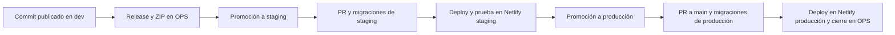

# Guía de releases de Referidos desde dev a producción

En Referidos, una **release** identifica el código que se quiere publicar. Un **artefacto** contiene los archivos compilados de esa release. Una **promoción** registra que esa release pasa a otro entorno. Un **deploy** publica los archivos en el sitio de ese entorno. Puedes tener una release promovida, con el PR aprobado, y que el sitio siga sirviendo la versión anterior. La confirmación final está en Netlify y en el registro de despliegue de OPS.

Auditoría del 21 de noviembre de 2026. El flujo usa el código de `dev` en el commit `802387b` como referencia, junto con comprobaciones de lectura de servicios remotos. La publicación y sus permisos efectivos dependen de la configuración y de la versión de cada workflow y función que estén activos en esos servicios.

## 1. Pasos para llevar una corrección a producción

### Qué pantalla abrir

Entra como administrador a **Versionado → Resumen** y elige **Referidos PWA**. **Publicar** reúne las acciones de release, sincronización y migraciones. **Solicitudes** muestra aprobación, ejecución y enlaces a GitHub y Netlify. **Builds** muestra artefactos y copias locales. **Actividad** reúne eventos y configuración por entorno. **Diagnóstico** permite comparar ramas y versiones. **Historial** abre el registro de cada release, con su versión, entorno y revisiones. Las rutas internas siguen siendo `/admin/versionado/global` y `/admin/versionado/detalle`. Prelaunch y Android se eligen como productos aparte. [Rutas de administración](../apps/referidos-app/src/routes.jsx#L291) · [Versionado](../apps/referidos-app/src/admin/versioning/VersioningOverviewPanel.jsx) · [Compilaciones](../apps/referidos-app/src/admin/versioning/VersioningArtifactsPanel.jsx)

Estos nombres corresponden a la interfaz reorganizada en el repositorio. En la versión anterior, **Versionado → Global → Updates** reunía las operaciones en una sola vista. El menú **Apps** administra el catálogo que usa Soporte. [Catálogo de Apps](../apps/referidos-app/src/admin/apps/services/supportAppsService.js)

| Paso | Qué haces | Qué compruebas antes de seguir |
| --- | --- | --- |
| **1 · Código en dev** | Termina las correcciones, ejecuta compilación y pruebas, haz commit y publica `dev` en GitHub. Anota el SHA. | GitHub muestra ese commit en `dev`. El push ejecuta detección y checks. La detección propone cambios y subida de versión. |
| **2 · Release de dev** | En Versionado, abre la vista previa de la release del producto. Confirma el SHA, el conjunto de cambios y la versión. Solicita la release y consulta la ejecución de **Versioning Release Dev**. | OPS muestra la versión con `source_commit_sha`. **Builds** muestra un artefacto con ID y número de build. Verifica que concluyeron la compilación, la subida y el registro, especialmente si el panel ya muestra un número de versión. |
| **3 · Candidata de staging** | Promueve la release de `dev` a `staging`. Usa **Subir release** si el SHA todavía falta en la rama. Abre el PR que indica el panel, revisa qué commits incluye y comprueba `detect`, `lint`, `test` y `build`. | El SHA de la release está contenido en `staging`. Los checks corresponden al HEAD actual del PR. Un PR con cambios de aplicación adicionales debe revisarse como tal, porque el mecanismo sincroniza la rama de origen. |
| **4 · Esquema de staging** | Ejecuta el gate de migraciones para esa versión. Si hay pendientes, revisa el proyecto y los SQL del commit. Usa **Apply migrations** sólo con ese destino confirmado. | Termina **Versioning Apply Migrations** y el gate vuelve en verde. Una solicitud aceptada indica que GitHub recibió el trabajo. Confirma la aplicación con el estado del workflow y el inventario remoto. |
| **5 · Publicación de staging** | Solicita y aprueba el deploy de la candidata. Ejecuta el pipeline, conserva el `request_id` y abre la ejecución de Actions. | El artefacto coincide con la release, Netlify publica en el sitio de staging y OPS registra el resultado. Abre el sitio y prueba instalación o arranque, login, rol, rutas críticas y una recarga en una ruta interna. Comprueba `app-config.js` y el runtime de staging. |
| **6 · Producción** | Promueve la candidata que probaste en staging. Repite la sincronización hacia `main`, el control de migraciones para el Supabase de producción y la aprobación del deploy. | El commit y el artefacto siguen siendo los aprobados en staging. Netlify confirma el sitio de producción y su deploy ID. OPS registra `success`. Comprueba la URL pública y que el archivo de configuración apunta al runtime de producción. |

[Detección en dev](../.github/workflows/versioning-detect-dev.yml#L3) · [Release de dev](../.github/workflows/versioning-release-dev.yml#L3) · [Sincronización del PR](../apps/referidos-ops/supabase/functions/versioning-release-sync/index.ts#L2647) · [Gate de migraciones](../apps/referidos-ops/supabase/functions/versioning-release-gate/index.ts#L334) · [Publicación](../.github/workflows/versioning-deploy-artifact.yml#L625)

### Qué hacer cuando el panel queda bloqueado

| Estado observado | Primer lugar que revisas | Cómo sigues |
| --- | --- | --- |
| Una URL de Versionado devuelve 404 al abrirla o recargar | Respuesta HTTP del sitio Netlify. | En las versiones publicadas consultadas puedes entrar por la raíz y navegar desde el menú. La corrección de rutas requiere desplegar el artefacto que contiene `_redirects`. |
| GitHub rechaza actualizar `staging` o `main` | PR, SHA de su HEAD, checks requeridos y reglas de la rama. | Corrige el fallo o conflicto en una rama de trabajo y actualiza el PR. Si el flujo usa sincronización `staging → main`, vuelve a certificar en staging las correcciones que quieras llevar a producción. |
| El panel dice que falta el SHA o pide **Subir release** | Release en OPS frente a la rama remota de destino. | Confirma producto y SHA. Abre el PR correcto. Si la corrección produjo un SHA nuevo, prepara la release de ese SHA y vuelve a aprobarla. |
| El panel dice que faltan migraciones | Lista requerida, inventario del Supabase de destino y log de Actions. | Distingue una migración pendiente de un inventario que no se pudo leer. Si el workflow falló, revisa el comando y el proyecto efectivo antes de reintentar. |
| Se pulsó **Deploy** y la interfaz dejó de actualizar | Actions, usando la ejecución o el `request_id`. Luego Netlify y el registro OPS. | Si hay una ejecución en curso, espera su resultado. Si Netlify ya publicó, concilia ese deploy y el callback. Reintenta una publicación sólo después de identificar qué parte terminó. |
| Falló la subida del artefacto o la descarga | Build de dev, proveedor registrado en OPS, existencia del ZIP y backup de Actions. | Recupera el ZIP del SHA aprobado y coteja su huella. El flujo `backfill_artifact` reconstruye desde el commit registrado, con una huella nueva que corresponde verificar antes de usar. |

Hay tres controles independientes. GitHub gobierna el merge. OPS gobierna la solicitud y su aprobación. El gate consulta el estado de migraciones. La sincronización de **workflow pack** tiene su propio PR para los archivos de automatización. Sirve para corregir una diferencia de workflows entre ramas. Usa el detalle del PR para distinguir ese caso de una regresión de la app. [Checks de PR](../.github/workflows/ci-pr.yml#L65) · [Sincronización del workflow pack](../apps/referidos-ops/supabase/functions/versioning-release-sync/index.ts#L1965) · [Ejecutor del deploy](../apps/referidos-ops/supabase/functions/versioning-deploy-execute/index.ts#L787)

**La ficha que permite rastrear un intento** reúne producto, entorno, versión, SHA de origen, `release_id`, `artifact_id`, `request_id`, ID y URL de GitHub Actions, ID y URL de Netlify y el último paso completado. El hash del artefacto identifica el ZIP. El hash de `app-config.js` identifica los datos públicos que se le añadieron para ese entorno. [Timeline y configuración](../docs/versioning-system.md#observabilidad-de-builds-y-config-por-entorno)

## 2. Proyectos, pipelines y copias que intervienen

### Mapa de Supabase y Netlify

La columna Netlify identifica los nombres observados en despliegues registrados en OPS. La selección efectiva del sitio se hace con los secretos `NETLIFY_SITE_ID_*` de GitHub, por producto y destino. El workflow web utiliza `--prod` para publicar como versión activa del **sitio seleccionado**. Por eso se ve esa opción también al publicar en el sitio de staging.

| Rama y entorno | Supabase de la aplicación | Netlify de Referidos App | Netlify de Prelaunch |
| --- | --- | --- | --- |
| `dev` · Desarrollo | `referidos-app-dev` · `btvrtxdizqsqrzdsgvsj` | Compilación y vista previa local. El workflow de artefactos carece de destino Netlify `dev`. | Mismo esquema de preparación y vista previa. |
| `staging` · Pruebas | `referidos-app-staging` · `iegjfeaadayfvqockwov` | `referidosapp-staging` · `NETLIFY_SITE_ID_REFERIDOS_APP_STAGING` | `testing-goplip` · `NETLIFY_SITE_ID_PRELAUNCH_WEB_STAGING` |
| `main` · Producción (`prod`) | `referidos-app` · `ztcsrfwvjgqnmhnlpeye` | `referidosapp` · `NETLIFY_SITE_ID_REFERIDOS_APP_PROD` | `join-goplip` · `NETLIFY_SITE_ID_PRELAUNCH_WEB_PROD` |
| Control compartido | `referidos-ops` · `ymhaveuksdzlfuecvkmx` | OPS registra los despliegues del producto. | OPS también registra Prelaunch. |

Los cuatro proyectos Supabase figuran activos en la CLI. En este checkout el proyecto enlazado desde la raíz es **referidos-ops**. Comprueba `--workdir` y el proyecto efectivo antes de operar: el SQL de la aplicación vive en `apps/referidos-app/supabase` y el SQL operativo en `apps/referidos-ops/supabase`. Los tres runtimes tienen sus propios usuarios, Auth, configuración, esquema y datos. OPS comparte el registro de releases, solicitudes, auditoría, artefactos y sincronizaciones. [Mapa de entornos](../docs/referidos-system/entornos-y-secrets.md#1-topologia-oficial) · [Contrato de variables](../versioning/env.contract.json) · [Destino y producto en el workflow](../.github/workflows/versioning-deploy-artifact.yml#L93)

`migo-beta.netlify.app` es otro sitio que se observó en el teléfono durante la prueba de instalación. La vista previa por ngrok es otro origen de pruebas y usó el Supabase de desarrollo. Registra ambos orígenes como pruebas auxiliares hasta confirmar en Netlify cómo se gestionan. El runbook original presupone auto-deploy desactivado. Verifica el ajuste antes de confiar en que un merge y una publicación son operaciones independientes en el sitio actual. [Pruebas HTTPS en Android](11-errores-pwa-en-telefono.md#google-oauth-en-la-webapk-por-https) · [Runbook original](../docs/referidos-system/operacion-sin-pr-netlify.md#1-supuestos)

### Productos y servicios por responsabilidad

| Pieza | Qué controla | Dónde se comprueba |
| --- | --- | --- |
| **Referidos App** (`referidos_app`) | PWA principal, incluido el panel admin. Su `dist` va a los destinos web de Referidos. | `apps/referidos-app`, su manifiesto, `app-config.js` y el sitio Netlify elegido. |
| **Prelaunch** (`prelaunch_web`) | Web de captación y lanzamiento. Comparte parte del runtime por entorno. | `apps/prelaunch`, sitios `testing-goplip` y `join-goplip`, catálogo de OPS. |
| **Android** (`android_app`) | App nativa. El mapa detecta sus componentes y registra versiones. | `apps/referidos-android`, CI Android y Gradle. El pipeline de artefacto web excluye su build y su deploy. Un APK de prueba de la máquina no acredita publicación. |
| **PWA anterior** (`apps/referidos-pwa`) | Proyecto separado de la PWA que contiene el panel admin. | El plan de deploy admite las dos claves web de esta tabla. Valida el producto por esa clave y por el workspace, especialmente al abrir `dist` o lanzar comandos locales. |
| **Versionado en OPS** | Relaciona changeset, versión SemVer, SHA, promoción, build, artefacto, solicitud y deploy. | `versioning-ops-proxy` valida el admin en el runtime y envía la operación a OPS. OPS despacha Actions y recibe callbacks. |

[Mapa de componentes y productos](../versioning/component-map.json) · [Proxy de administración](../apps/referidos-app/supabase/functions/versioning-ops-proxy/index.ts#L1261) · [CI Android](../.github/workflows/ci-android-pr.yml) · [Productos elegibles en Release Dev](../.github/workflows/versioning-release-dev.yml#L293)

### Pipelines que se activan y resultado de cada uno

| Pipeline | Disparador | Salida que debes encontrar |
| --- | --- | --- |
| **Versioning Detect Dev** | Push a `dev` o `develop`. | Changeset y checks del commit. `detect-changes.mjs` aplica `component-map.json` al diff. Las rutas excluidas pueden producir una propuesta vacía. |
| **Versioning Detect PR** y **CI PR Gates** | PR a las ramas contempladas por los workflows. | Clasificación y checks. Hay un tratamiento especial para PR de sólo workflow pack y CI específico de Android. |
| **Versioning Release Dev** | Botón de release o despacho manual. | Registra el changeset y la release, construye el producto web, archiva backup de Actions, sube ZIP a Storage y registra el artefacto. `backfill_artifact` recompila una release registrada desde su SHA. |
| **Promoción y sincronización de rama** | Panel → OPS. | Promoción en OPS y, si falta el SHA, PR hacia la rama de destino. El repo también contiene workflows y herramientas de operación manual. |
| **Versioning Apply Migrations** | Despacho desde OPS para una versión y destino. | Checkout del commit y ejecución de Supabase CLI contra el runtime de destino. El gate posterior comprueba las migraciones requeridas. |
| **Versioning Deploy Artifact** | Solicitud ejecutada desde OPS. | Descarga el artefacto, prepara el directorio de publicación, escribe `app-config.js` y envía sourcemaps a observabilidad. Publica en Netlify, gestiona el tag cuando corresponde y reporta resultado a OPS. |
| **Versioning Local Artifact Sync** | **Builds → Sync a PC**, con un nodo elegible. | Runner Windows descarga la copia, escribe el destino y devuelve estado. El deploy remoto puede funcionar con el runner local apagado. |

[Workflows](../.github/workflows) · [Detección y SemVer](../tooling/versioning/detect-changes.mjs) · [Timeline](../docs/versioning-system.md#observabilidad-de-builds-y-config-por-entorno)

### Dónde vive cada copia

| Copia | Ubicación | Uso y límite |
| --- | --- | --- |
| **Código fuente local** | Este checkout y sus ramas Git. | Sirve para editar y probar. Actions usa código que ya está en GitHub. En la consulta, el commit local `802387b` de `dev` estaba cuatro commits por delante del `dev` remoto `e9c64d1`. |
| **Build local de trabajo** | `apps/referidos-app/dist` o `apps/prelaunch/dist`. | `npm run build:app` o `npm run build:prelaunch`. Puede incorporar cambios locales y configuración de pruebas. |
| **Backup de Actions** | Artefacto `<nombre>-backup` de **Versioning Release Dev**. | Copia de rescate con retención configurada de 30 días. Revisa si conserva el ZIP y si expiró. |
| **ZIP de la release** | Storage privado `versioning-artifacts` del proyecto OPS, bajo producto, versión y prefijo del SHA. | Copia que normalmente usa el deploy. La fila `version_release_artifacts` guarda proveedor, ruta, checksum y referencias del build. `version_artifact_env_heads` muestra qué artefacto está asociado a cada canal. La limpieza de Storage puede retirar ZIP sin referencias. |
| **Archivo en la PC** | El nodo `pc-sebas` usa `D:\referidos-builds`. El script manual usa `versioning/local-artifacts/<producto>/<artifact_key>/bundle` y `registry.json`. | En `D:\referidos-builds` hay tres copias de dev, Referidos App `0.1.5` y `0.1.6`, y Prelaunch `0.1.1`. El archivo manual del checkout sólo tenía su marcador. Busca la copia por SHA antes de usarla para recuperar un deploy. |
| **Deploy preparado** | Directorio de publicación de la ejecución de Actions. | Copia temporal con configuración pública del destino. `app-config.js` contiene URL de Supabase, clave publicable y metadatos de release. Las credenciales de servidor se quedan en CI y Edge Functions. |
| **Publicado en Netlify** | El deploy ID de ese sitio y su URL única. | Es la evidencia de archivos servidos. Para verificar qué ve el usuario, comprueba también el dominio de producción del sitio y cuál es su deploy activo. |
| **Snapshot en el runtime** | Supabase de destino, vía `obs-release-sync`. | Enlaza errores de la app con la release y sus componentes. Los bytes del ZIP y las cuentas de los otros entornos se gestionan por separado. |

[Backup y Storage](../.github/workflows/versioning-release-dev.yml#L368) · [Registro y copia manual](../tooling/versioning/archive-local-artifact.mjs#L120) · [Runner local](../.github/workflows/versioning-local-artifact-sync.yml#L142) · [Retención de artefactos](../apps/referidos-ops/supabase/migrations/20260316_000032_versioning_artifact_storage_gc.sql) · [Preparación del sitio](../.github/workflows/versioning-deploy-artifact.yml#L494)

La promoción copia referencias de versión y componentes dentro de OPS. Cada runtime conserva su propia base. El ZIP de Storage y el archivo local sirven para recuperar un frontend. El esquema, los datos y las Edge Functions requieren su propio plan de recuperación. El deploy web prepara archivos estáticos, y las migraciones del runtime tienen un workflow separado. [Promoción](../tooling/versioning/promote-release.mjs) · [Migraciones](../.github/workflows/versioning-apply-migrations.yml)

### Lo que se comprobó en los entornos

- **GitHub.** `dev` apunta a `e9c64d1` y la API lo reporta sin protección. `staging` apunta a `fa919a8` y `main` a `9619781`, ambas reportadas como protegidas. La lectura pública no reveló los checks y excepciones efectivos de las reglas. El PR asociado a `fa919a8` tiene runs exitosos de detección y CI web. Las referencias `origin/staging` y `origin/main` de este checkout están atrasadas frente a la consulta directa. [Ramas remotas](https://github.com/sebasApps-lab/referidos-app/branches) · [Detección PR](https://github.com/sebasApps-lab/referidos-app/actions/runs/24310704154) · [CI PR](https://github.com/sebasApps-lab/referidos-app/actions/runs/24310704167)
- **Netlify.** Los cuatro `app-config.js` públicos respondieron HTTP 200 y apuntaron al Supabase esperado. Referidos App sirve `0.1.7` en staging y prod, y Prelaunch sirve `0.3.4` en ambos. `migo-beta` respondió 404 en `app-config.js`. El conector de Netlify pidió autenticación, por lo que siguen pendientes la confirmación de los IDs configurados en GitHub, la vinculación de repos, el estado del auto-deploy, los alias y los permisos del dashboard. [Referidos staging](https://referidosapp-staging.netlify.app/) · [Referidos producción](https://referidosapp.netlify.app/) · [Prelaunch staging](https://testing-goplip.netlify.app/) · [Prelaunch producción](https://join-goplip.netlify.app/)
- **OPS.** El historial registra despliegues exitosos de Referidos App `0.1.7` en staging y producción el 29 de marzo. Para Prelaunch `0.3.4` registra staging el 12 de abril y producción el 15 de abril, en hora de Guayaquil. Las funciones principales de versión, gate, sincronización, ejecución y callback figuran activas. La lista de funciones no demuestra que su código coincida con este checkout. [Referidos staging en Actions](https://github.com/sebasApps-lab/referidos-app/actions/runs/23715495728) · [Referidos producción en Actions](https://github.com/sebasApps-lab/referidos-app/actions/runs/23715940844) · [Prelaunch staging en Actions](https://github.com/sebasApps-lab/referidos-app/actions/runs/24310257510) · [Prelaunch producción en Actions](https://github.com/sebasApps-lab/referidos-app/actions/runs/24491050627)
- **Copias y migraciones.** La sincronización local `23698156165` terminó en el runner `pc-sebas`, cuyo servicio estaba en ejecución durante la revisión. El ZIP que conserva el runner coincide con los 91 archivos de la copia local de Referidos App `0.1.6`. La API de Actions devolvió cero artefactos descargables para el repositorio. No aparecieron ejecuciones históricas de **Versioning Apply Migrations** en la consulta del workflow. Los historiales aplicados de los tres runtimes requieren comprobaciones aparte. [Sincronización efectiva](https://github.com/sebasApps-lab/referidos-app/actions/runs/23698156165) · [Workflow de migraciones](https://github.com/sebasApps-lab/referidos-app/actions/workflows/versioning-apply-migrations.yml)

En Storage de OPS encontré los objetos de los seis punteros activos indicados abajo. Todos tenían un checksum registrado. Se comprobó su existencia en `storage.objects`. La descarga y el recálculo de la huella de cada ZIP quedan pendientes. No aparecieron punteros de Android en la consulta. [Definición del registro y los punteros](../apps/referidos-ops/supabase/migrations/20260315_000031_versioning_artifact_registry_local_sync.sql#L3)

| Producto | Puntero dev | Puntero staging | Puntero prod |
| --- | --- | --- | --- |
| Referidos App | `0.2.2` · `189ff88c5ddb` | `0.1.7` · `092d02e5524a` | `0.1.7` · `092d02e5524a` |
| Prelaunch | `0.3.4` · `e9c64d1e9409` | `0.3.4` · `e9c64d1e9409` | `0.3.4` · `e9c64d1e9409` |

## 3. Errores encontrados y orden para corregirlos

### Prioridad crítica · Identidad, ejecución y artefacto

#### 1. La aprobación puede quedar bloqueada o saltarse sin que el operador lo vea

El servidor identifica al administrador autenticado, pero al solicitar y aprobar toma una etiqueta de actor si viene en la petición. Desde Android la etiqueta por defecto es `android-admin`. El SQL de cuatro ojos compara esa etiqueta, así que dos personas distintas en Android pueden parecer la misma. En la PWA la ruta de **Deploy** por versión envía `forceAdminOverride: true`. El botón **Aprobar** también envía override, aunque el nombre del botón sugiere la aprobación normal. Esto mezcla la regla diaria con la excepción de emergencia. [Proxy de actores](../apps/referidos-app/supabase/functions/versioning-ops-proxy/index.ts#L562) · [Cliente Android](../apps/referidos-android/src/shared/services/versioningService.ts#L386) · [Regla SQL](../apps/referidos-ops/supabase/migrations/20260303_000022_versioning_admin_override_service_role.sql#L45) · [Deploy PWA](../apps/referidos-app/src/admin/versioning/VersioningOverviewPanel.jsx#L2517)

**Corrección.** Derivar la identidad de la sesión en servidor y guardar por separado el cliente web o Android. Definir quién puede operar cada entorno y aplicar cuatro ojos a producción. Una excepción debe mostrar su alcance, pedir motivo y dejar auditoría. Android debe ofrecer acciones que correspondan al estado real y al producto. Probar con dos admins distintos y con una misma persona en web y Android.

#### 2. OPS conserva intentos abiertos aunque Netlify ya terminó

En la lectura de OPS había **28 filas `started` sin `finished_at`** en Referidos App y Prelaunch. Un caso confirmado es **Prelaunch `0.3.4` en producción**, con dos filas de la ejecución GitHub `24491050627`. Una tiene el ID provisional `gha-1776311456245-9328125b` y sigue en `started`. La otra usa el ID Netlify `69e05ce527c3855c45aac18d` y está en `success`. Son dos registros de la misma ejecución. La UI puede mostrar actividad fantasma si interpreta cada fila como un intento independiente. [Run confirmado](https://github.com/sebasApps-lab/referidos-app/actions/runs/24491050627) · [Captura de ID Netlify](../.github/workflows/versioning-deploy-artifact.yml#L640) · [Cierre de solicitud OPS](../apps/referidos-ops/supabase/functions/versioning-deploy-callback/index.ts#L600)

OPS despacha Actions y después registra `started`. El proxy reintenta algunas llamadas transitorias. Si falla el registro, puede haber una ejecución real que ya recibió GitHub. La deduplicación SQL protege solicitudes en `pending` y `approved`. Por sí sola, queda corta para serializar dos publicaciones distintas al mismo sitio. El callback también puede cerrar la solicitud y fallar más tarde en metadatos o en el puntero al artefacto del entorno. [Orden de despacho](../apps/referidos-ops/supabase/functions/versioning-deploy-execute/index.ts#L1001) · [Reintentos del proxy](../apps/referidos-app/supabase/functions/versioning-ops-proxy/index.ts#L118) · [Deduplicación](../apps/referidos-ops/supabase/migrations/20260222_000015_versioning_deploy_gate.sql#L44) · [Metadatos del callback](../apps/referidos-ops/supabase/functions/versioning-deploy-callback/index.ts#L652)

**Corrección.** Crear un intento persistente antes del despacho, asociarlo al run y luego al ID Netlify en la misma fila. Hacer despacho y callback idempotentes por intento. Serializar por producto y destino y añadir conciliación para estados sin callback. Modelar por separado «publicado en Netlify», «registrado en OPS» y «snapshot actualizado». La conciliación histórica debe usar IDs verificables y preservar auditoría. Probar doble clic, pérdida de respuesta, callback repetido y error posterior a publicar.

#### 3. El pipeline llamado «artefacto exacto» no comprueba toda la identidad

Si el deploy no encuentra un artefacto por `release_id`, busca por producto y versión. Exporta el SHA del artefacto, y los pasos de descarga no lo comparan con el SHA de la release ni verifican el checksum que registró dev. Si Storage falla antes de registrar metadata, queda una release en OPS y puede existir un backup en GitHub que el deploy no sabe localizar automáticamente. La confirmación de la identidad es importante también al reconstruir un artefacto. [Selección del artefacto](../.github/workflows/versioning-deploy-artifact.yml#L331) · [Descarga](../.github/workflows/versioning-deploy-artifact.yml#L430) · [Checksum y backup](../.github/workflows/versioning-release-dev.yml#L351)

**Corrección.** Resolver por producto, release y SHA inmutable. Verificar la huella del ZIP antes de extraer y publicar. Mostrar en Admin qué copia está disponible y cuál fue su origen. Seleccionar una versión con el mismo SemVer de otro producto, o alterar un ZIP en un entorno de prueba, debe detener el proceso antes de publicar.

**Recuperación.** La limpieza de OPS puede borrar un ZIP que ya no tenga puntero de entorno. El código no consulta el inventario de la PC ni la disponibilidad del backup de Actions para decidirlo. Define cuántas versiones previas conservar para recuperación y comprueba que el artefacto anterior se pueda descargar antes de promover. [Limpieza de Storage](../apps/referidos-ops/supabase/functions/versioning-deploy-callback/index.ts#L267)

#### 4. El gate de migraciones dice menos de lo que aparenta

Compara las migraciones del changeset con el inventario del runtime. Con un changeset sin SQL, el gate puede pasar aunque exista una diferencia previa en ese entorno. El workflow imprime `REQUIRED_MIGRATIONS`, mientras que `db push` calcula las pendientes del checkout que va a aplicar. También instala CLI `latest` y le pasa `--project-ref`. En la CLI local `2.84.2` el selector para `db push` es distinto. La documentación v3 mantiene `--project-ref` como opción de transición. Sin ejecuciones históricas de ese workflow, la compatibilidad exige una prueba controlada. Android presenta «Migraciones aplicadas» al recibir el despacho, antes de la confirmación de GitHub. [Gate](../apps/referidos-ops/supabase/functions/versioning-release-gate/index.ts#L195) · [Workflow](../.github/workflows/versioning-apply-migrations.yml#L98) · [Estado mostrado en Android](../apps/referidos-android/src/features/admin/AdminVersioningScreen.tsx#L812) · [Referencia de la CLI de Supabase](https://supabase.com/docs/reference/cli/global-flags#supabase-db-push)

**Corrección.** Fijar la versión de CLI, validar referencia del destino y contrastar un plan de ejecución en seco con lo aprobado. Mostrar `solicitadas`, `aplicando`, `verificadas` o `fallidas` a partir del run y del inventario nuevo. Agregar una verificación de paridad de esquema separada del gate por release.

#### 5. Los cuatro sitios publican el mapa de código del bundle principal

Las solicitudes `HEAD` a los `.map` del bundle principal devolvieron HTTP 200 con `application/octet-stream` en los cuatro sitios de la tabla. Los proyectos generan mapas ocultos con fuentes incluidas. El workflow sube mapas a observabilidad desde una copia para ese fin y publica otro directorio que conserva los mapas. [Build de la PWA](../apps/referidos-app/vite.config.js#L38) · [Build de Prelaunch](../apps/prelaunch/vite.config.js#L50) · [Preparación y publicación](../.github/workflows/versioning-deploy-artifact.yml#L494)

**Corrección.** Mantener los mapas en el destino privado necesario para diagnosticar errores y excluirlos del directorio publicado. Verificar que la aplicación sigue resolviendo las trazas y que los `.map` dejan de estar accesibles en el nuevo despliegue. Revisar también la accesibilidad de deploys anteriores que los incluyeron.

### Prioridad alta · Ramas, diagnósticos y claridad de Admin

| Problema | Efecto y corrección |
| --- | --- |
| **El PR y la release pueden abarcar commits distintos.** | La sincronización fusiona el HEAD validado del PR. Si `dev` avanzó desde la release elegida, la rama de staging puede recibir más cambios que el ZIP. Mostrar el SHA de la release, el HEAD a fusionar y el alcance del PR en la misma vista. Validar estados de checks exactos y distinguir «omitido» de «pasó». [Merge y comprobación de SHA](../apps/referidos-ops/supabase/functions/versioning-release-sync/index.ts#L2647) · [Checks inferidos](../apps/referidos-ops/supabase/functions/versioning-release-sync/index.ts#L448) |
| **Un check `test` exitoso puede haber ejecutado cero pruebas.** | CI web usa `npm run test ... --if-present` y la PWA carece de script `test`. En el workflow pack hay caminos que omiten algunos gates por diseño. Mostrar tipos de cambio y el número de pruebas, e incorporar pruebas obligatorias para el camino de release. [CI web](../.github/workflows/ci-pr.yml#L154) · [Scripts PWA](../apps/referidos-app/package.json) |
| **Abrir o recargar el detalle falla en los dos sitios publicados de la PWA.** | La raíz devuelve HTTP 200. Las peticiones GET a `/admin/versionado/global`, `/admin/versionado/detalle` y `/auth` devuelven 404 en staging y producción. React Router puede navegar desde una pestaña que ya cargó la raíz. Verifica que el próximo artefacto incluya `_redirects` y prueba las tres rutas directas en ambos destinos. [Rutas de la app](../apps/referidos-app/src/routes.jsx#L291) · [Regla SPA de dev](../apps/referidos-app/public/_redirects) |
| **«Ver logs» puede abrir la aplicación publicada.** | El workflow pone la URL de Netlify en el campo `logs_url`, mientras que la URL de Actions va en metadata. Mostrar enlaces distintos para **Logs de Actions**, **Deploy en Netlify** y **Sitio publicado**. En un fallo mostrar primero fase, paso, código y detalle útil, seguido del intento y SHA. [Cómo se guarda la URL](../.github/workflows/versioning-deploy-artifact.yml#L640) · [Botón de la PWA](../apps/referidos-app/src/admin/versioning/VersioningOverviewPanel.jsx#L3725) |
| **El seguimiento se pierde o se queda con información anterior.** | Cambiar producto limpia la selección del seguimiento. El polling consulta un conjunto global limitado y los errores reiterados pueden impedir que se cumpla el plazo de pantalla. La validación de un entorno puede quedar visible al cambiar a otro. En Detalle, **Actualizar** refresca el catálogo y puede dejar los componentes e historial anteriores. Volver a consultar un intento por ID estable, conservarlo entre navegaciones y etiquetar producto, entorno y hora de cada validación. [Seguimiento](../apps/referidos-app/src/admin/versioning/VersioningOverviewPanel.jsx#L1284) · [Cambio de producto](../apps/referidos-app/src/admin/versioning/VersioningOverviewPanel.jsx#L1513) · [Explorador](../apps/referidos-app/src/admin/versioning/VersioningReleaseExplorerPanel.jsx#L193) |
| **Cancelar el rechazo en la PWA puede rechazar la solicitud.** | El diálogo convierte `null` en una razón vacía y continúa. Usar confirmación explícita y probar cancelar, cerrar y confirmar. [Acción de rechazo](../apps/referidos-app/src/admin/versioning/VersioningOverviewPanel.jsx#L3092) |
| **Android permite registrar un éxito manual.** | **Marcar ejecutado** puede guardar `success` y generar un ID manual sin verificar una publicación. Además, muestra acciones de aprobar o ejecutar en filas que ya pasaron por esas etapas. Reservar la conciliación a un operador autorizado y exigir evidencia externa. Ocultar acciones inaplicables. [Acciones Android](../apps/referidos-android/src/features/admin/AdminVersioningScreen.tsx#L854) · [Registro de ejecución](../apps/referidos-app/supabase/functions/versioning-ops-proxy/index.ts#L629) |
| **El tag puede fallar después de publicar.** | El tag `vX.Y.Z` se escribe después de Netlify. Si ya existe se omite sin cotejar el SHA. Dos productos comparten repositorio y pueden coincidir en SemVer. Usar tags por producto, comprobar si el existente apunta al SHA previsto y tratar por separado un error de tag y un error de publicación. [Tag y callback](../.github/workflows/versioning-deploy-artifact.yml#L642) |
| **Apps mezcla guardado con sincronización.** | La carga del catálogo dispara una sincronización completa hacia el runtime. En una edición, OPS puede guardar el registro y la UI puede presentar el proceso como fallo si falla la sincronización posterior. Hacer que abrir la pantalla sólo lea. Mostrar «guardado en OPS» y «caché actualizada» con estados independientes. [Servicio web de Apps](../apps/referidos-app/src/admin/apps/services/supportAppsService.js#L72) · [Servicio Android](../apps/referidos-android/src/shared/services/supportOps.ts#L97) |
| **Los últimos runs exitosos son anteriores al cambio de runtime de Actions.** | Los runs de abril registraron avisos de acciones definidas para Node 20, como `checkout@v4` y `upload-artifact@v4`. GitHub retiró Node 20 para acciones JavaScript en septiembre de 2026. Verificar versiones compatibles con Node 24 en staging y en el runner local. Esta comprobación es independiente de la versión de Node con la que compila el proyecto. [Workflow de dev](../.github/workflows/versioning-release-dev.yml#L44) · [Cambio de GitHub Actions](https://github.blog/changelog/2026-09-23-node-20-is-no-longer-available-in-github-actions/) |

Hay ejecuciones históricas fallidas de deploy y de sincronización local. Sus anotaciones públicas sólo conservan el código de salida y GitHub ya retiró el log. Esos runs confirman el fallo, pero su causa concreta queda indeterminada. El panel debería conservar el nombre del paso y un resumen del error depurado cuando se produce. [Deploy fallido](https://github.com/sebasApps-lab/referidos-app/actions/runs/24299993395) · [Sync fallido](https://github.com/sebasApps-lab/referidos-app/actions/runs/22513365792)

### Cuándo dar el flujo por reparado

1. **Primero, integridad del backend.** Identidad de actor, aprobación de producción, intento persistente, bloqueo por destino y verificación de artefacto. Una ejecución aceptada debe poder retomarse desde cualquier sesión del panel y cerrar el mismo intento.
2. **Después, una vista de operación por release.** Mostrar `Dev → Staging → Producción`, un próximo paso habilitado por estado y una explicación para cada bloqueo. Dejar detalles de PR, migraciones, hash, versión de config y URLs bajo el mismo intento. Un error debe decir qué fase falló, qué pudo terminar y dónde revisar la evidencia.
3. **Finalmente, ensayar en staging.** Una release completa con dos aprobadores, una migración pendiente, un PR con checks fallidos, una caída durante el callback y una recuperación desde el artefacto anterior. Verificar que ninguna de esas pruebas exige desproteger ramas. Acordar cómo restaurar un frontend anterior compatible y cómo corregir o restaurar la base según el cambio efectuado.

El paso de producción queda habilitado cuando staging demuestra la relación entre el SHA, el hash del artefacto, el destino y el estado final. Antes de operar producción, coteja los `NETLIFY_SITE_ID_*` efectivos, las reglas administradas de GitHub y el estado del auto-deploy en cada sitio. Esas comprobaciones requieren acceso a los paneles de administración o a sus APIs autenticadas.
